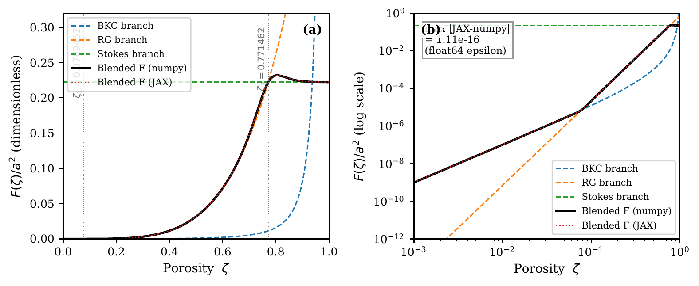
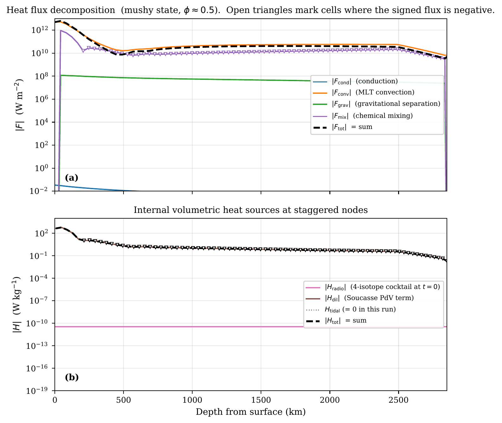

# Heat transport

Aragog assembles the total radial heat flux at each basic node from four independently configurable contributions:

$$
F_\mathrm{tot} = F_\mathrm{cond} + F_\mathrm{conv} + F_\mathrm{grav} + F_\mathrm{mix}.
$$

Each term is gated by a boolean in the `[energy]` section (`conduction`, `convection`, `gravitational_separation`, `mixing`); a flux that is disabled is identically zero. Internal heating sources (radiogenic, tidal) are documented separately in [Energy equation](energy_equation.md).

All flux formulas below use the entropy gradient $\partial S/\partial r$ as the primary driver. Temperature, density, heat capacity, thermal expansivity, and the isentropic temperature gradient $(\partial T/\partial P)_S$ are looked up from the EOS at $(P, S)$ on every RHS evaluation.

## Conduction

The Fourier flux is rewritten in entropy form using the thermodynamic identity $\partial T/\partial r |_S = (T/c_p)\,\partial S/\partial r$ and the EOS-tabulated isentropic temperature gradient:

$$
F_\mathrm{cond}
= -k\left[\frac{T}{c_p}\,\frac{\partial S}{\partial r} + \left.\frac{\partial T}{\partial P}\right|_S \frac{\partial P}{\partial r}\right].
$$

The pressure gradient is the configured profile (Adams-Williamson or external mesh file). When the entropy gradient vanishes (an isentropic profile) the conduction flux reduces to the adiabatic part alone, which is non-zero because the EOS provides $(\partial T/\partial P)_S$ directly. In the production path with PALEOS tables, $k$ is read from the EOS as a function of $(P, S)$; the `phase_solid.thermal_conductivity` and `phase_liquid.thermal_conductivity` config keys are kept only for the constant-properties analytical mode.

## Convection (mixing-length theory)

Convection is parameterised as eddy diffusion of entropy:

$$
F_\mathrm{conv} = -\rho T \kappa_h \tfrac{\partial S}{\partial r},
$$

with $\kappa_h > 0$ on unstable nodes, on nodes with the floor and on the CMB node, which takes $\kappa_h$ of the node above it (for the default positive `eddy_diffusivity_thermal`; a negative value sets $\kappa_h$ to its magnitude on every node, raised to the floor on nodes below $D$). The mixing-length drive acts only where $\partial S/\partial r < 0$, the usual instability criterion and the switch of SPIDER, and there it uses $\max(|\partial S/\partial r|, D)$: for $D > 0$ an unstable node next to the adiabat gets at least the eddy diffusivities $\kappa_h$ and $\kappa_c$ of a gradient $D$, while $F_\mathrm{conv}$ still goes to zero with $\partial S/\partial r$. The phase-modulated [floor](#phase-modulated-floor) applies wherever $\partial S/\partial r < D$, where $D$ is `energy.convective_threshold` (default 0; the numbers below use $D = 10^{-6}$ J kg$^{-1}$ K$^{-1}$ m$^{-1}$). For $D > 0$ a node just on the stable side ($0 \le \partial S/\partial r < D$) therefore keeps the floor diffusivity and no mixing-length diffusivity, so a near-zero stable gradient still diffuses; a node with a stable gradient above $D$ gets neither. Both are hard masks, and the default $D = 0$ gives the $\partial S/\partial r < 0$ switch with no minimum drive and no floor band.

$D = 10^{-6}$ gives one end state in the replayed coupled calls described below, which end in one of two states under the plain switch, but $D > 0$ can stall CVODE, also at `rtol` = `atol` = $10^{-8}$. The minimum drive makes $\kappa_h$ jump at $\partial S/\partial r = 0$ from the floor to the mixing-length value of a gradient $D$ (where that value is above the floor), so a node whose gradient stays near 0 changes sign again and again, and CVODE takes steps of about the relaxation time $\Delta r^2/\kappa_h(D)$ of that node. In the grey-body setup of `TestCvodeEnergyOutputGrid` in `tests/test_entropy_verification.py` with 2 output points, `core_bc` `quasi_steady` and `rtol` = `atol` = $10^{-8}$, 1 of 30 starts perturbed by a relative $10^{-9}$ reached the CVODE step limit at $D = 10^{-6}$ (at 892.9 yr of a 5000 yr call), and 0 of 30 at $D = 0$ (too few runs to give a rate); in the stalled call $\kappa_h$ of the CMB node changed between 8.45 and $2.0 \times 10^6$ m$^2$ s$^{-1}$, and the steps were near $\Delta r^2/\kappa_h(D) = 2.6 \times 10^{-5}$ yr. The width-0 solve of `test_rate_mode_arms_for_a_cell_inside_a_stiff_zone_wider_than_the_margin` in `tests/test_phase_boundary_cap.py` takes 183724 CVODE steps at $D = 10^{-6}$ and 518 at $D = 0$, both at `rtol` = `atol` = $10^{-6}$. The probe scripts are not in the repository.

$D = 10^{-6}$ sits between the gradients of a liquid layer and of a mush. In one coupled 1 $M_\oplus$ run with 80 mesh levels (the run is not in the repository), the median $|\partial S/\partial r|$ is $2$ to $4 \times 10^{-7}$ J kg$^{-1}$ K$^{-1}$ m$^{-1}$ in the liquid layer, while the mush has at least $3 \times 10^{-5}$ and a crystallisation front $2 \times 10^{-3}$ to $0.1$. So $D$ acts mainly on liquid nodes near the adiabat; a mush or front node is in the band $0 \le \partial S/\partial r < D$ only while its gradient passes through it. A solid node in the band gets the floor at $f(0) = 4.8 \times 10^{-3}$, 0.048 m$^2$ s$^{-1}$ at `kappah_floor` = 10, and a downward flux of at most $\rho T\,\kappa_h^\mathrm{floor} f(0)\,D$, about 1 W m$^{-2}$ for $\rho T = 2 \times 10^7$ kg K m$^{-3}$. These floor values hold with the rheology off. With `rheology.enabled = true` the floor in a fully solid cell ($\phi = 0$) is exactly 0 ([Solid-state convection, Section 6](solid_state_convection.md#6-interaction-with-the-eddy-diffusivity-floor)).

In the band $0 \le \partial S/\partial r < D$ the flux is $-\rho T \kappa_h^\mathrm{floor}(\phi)\, \partial S/\partial r$, downward and at most $\rho T \kappa_h^\mathrm{floor} D$, about $2 \times 10^2$ W m$^{-2}$ for $\rho T = 2 \times 10^7$ kg K m$^{-3}$, `kappah_floor` = 10 m$^2$ s$^{-1}$ and $D = 10^{-6}$. Where $(\partial T/\partial P)_S > 0$, the temperature still falls upward in the band (the superadiabatic part $(T/c_p)\,D$ is far below the adiabatic gradient), so this flux runs against the temperature gradient and lowers the total entropy; the bound above limits that term. The flux drops to zero at $D$, a jump of at most the same size, and the flux law is anti-diffusive at that point: a stable gradient close to $D$ is pushed away from $D$. The chemical eddy diffusivity $\kappa_c$ is built from the mixing-length value, which is zero in the band, so the [mixing flux](#chemical-mixing-of-melt-fraction) does not act there; only for $0 \le \partial S/\partial r$ below about $10^{-22}$ does the numpy path keep a residual drive ($5 \times 10^{-31}$ at 0, falling to 0 near $10^{-22}$) from the smoothing of $|\partial S/\partial r|$, which gives $\kappa_c$ (and $\kappa_h$ when the floor is off) of order $10^{-18}$ m$^2$ s$^{-1}$ or less in a mush and $10^{-8}$ to $10^{-7}$ in a liquid in test states; the value depends on the EOS tables and the mixing length, and the JAX path gives 0. On the unstable side the minimum drive keeps $\kappa_c$ at its value for $D$ as $\partial S/\partial r \to 0$, and the mixing bracket is set by the slope of the phase boundaries, so in a mush the mixing flux jumps at $\partial S/\partial r = 0$: on a test mush at a melt fraction of 0.4 (30 cells) it is downward just below zero, with a median of $8 \times 10^9$ W m$^{-2}$ over the nodes at least 2 cells from a boundary (up to $3 \times 10^{10}$), and off above. In replays of three coupled calls that end in one of two states under the plain switch (the replay script and its inputs are not in the repository), the minimum drive at $D = 10^{-6}$ gives one state, equal to the result of the same call at an rtol of $10^{-10}$; a minimum drive for $\kappa_h$ alone does not. At the CMB basic node $\kappa_h$ is copied from the node above it and multiplied by the CMB gradient, so the convective CMB flux jumps when that node crosses a switch (`core_bc` `energy_balance` and `gradient`): at 0 by $\rho T (\max(\kappa_h(D), \kappa_h^\mathrm{floor}(\phi)) - \kappa_h^\mathrm{floor}(\phi))\,|\partial S/\partial r|_\mathrm{cmb}$, where $\kappa_h(D)$ is the mixing-length value of a gradient $D$ (the jump is zero when that value is below the floor, as in a solid or viscous mush; both jumps are given for a positive `eddy_diffusivity_thermal`), and at $D$ by $\rho T \kappa_h^\mathrm{floor}(\phi)\,|\partial S/\partial r|_\mathrm{cmb}$. With a mixing length of 100 km in a test mush at a melt fraction of 0.4, $\kappa_h$ of the CMB node falls at 0 from $8.6 \times 10^4$ to the floor value of 5 m$^2$ s$^{-1}$, a jump of about $1.5 \times 10^8$ W m$^{-2}$ for $\rho T = 1.8 \times 10^7$ kg K m$^{-3}$ and a CMB gradient of $-10^{-4}$; at $D = 0$ it falls continuously to the floor value as the gradient of the node above goes to 0, and the CMB flux jumps there only by the floor term. With `quasi_steady` $F_\mathrm{cmb}$ follows the total flux of the node above (its mixing-flux jump at 0 in a mush and its floor jump at $D$), scaled by the split of heat capacity between the core and the first cell; with `core_module` and `bower2018` the core model sets $F_\mathrm{cmb}$.

There is no explicit "superadiabatic gradient" subtraction in the entropy formulation: the adiabat corresponds to $\partial S/\partial r = 0$, so the entropy gradient itself measures departures from the adiabat.

### Eddy diffusivity

$\kappa_h$ is the product of a mixing length $l(r)$ and a regime-dependent velocity scale. Following Abe (1993)[^cite-abe1993], Aragog blends the viscous and inviscid limits via a $\tanh$ on the cell Reynolds number:

$$
v_\mathrm{visc} = \frac{\alpha\,g\,T\,(-\partial S/\partial r)\,l^3}{18\,\nu\,c_p},\qquad
v_\mathrm{inv} = \left[\frac{\alpha\,g\,T\,(-\partial S/\partial r)\,l^2}{16\,c_p}\right]^{1/2},
$$

$$
\kappa_h = l\,[(1-w)\,v_\mathrm{visc} + w\,v_\mathrm{inv}],\qquad
w = \tfrac{1}{2}\Big[1 + \tanh\!\big((\mathrm{Re} - Re_\mathrm{crit})/\Delta\big)\Big],
$$

with $\mathrm{Re} = v_\mathrm{visc}\,l / \nu$ and a narrow blend width $\Delta = 0.01\,Re_\mathrm{crit}$. The critical Reynolds number $Re_\mathrm{crit} = 9/8$ that Aragog inherits comes via Abe (1995)[^cite-abe1995] and is documented in Bower et al. (2018)[^cite-bower2018] §2.1. The narrow blend keeps inviscid mixing confined to the convecting regime; widening it leaks inviscid $\kappa_h$ into the solid phase and induces $T_\mathrm{core}$ bistability.

### Mixing length profile

| `mixing_length_profile` | Formula |
|-------------------------|---------|
| `"nearest_boundary"` | $l(r) = \min(r_\mathrm{top} - r,\ r - r_\mathrm{cmb})$ |
| `"constant"` | $l$ = configured fraction of mantle thickness |

When solid-state mantle rheology is enabled (`[phase_solid.rheology]`), the top boundary mixing-length slope $s_\mathrm{top}$ scales with the viscosity contrast in the upper thermal boundary layer, and a stagnant lid can suppress convective transport near the surface. See [Solid-state convection](solid_state_convection.md) for rheology laws, stagnant-lid stress closures, and boundary slope scalings.

### Phase-modulated floor

A phase-aware floor on $\kappa_h$ is set by `kappah_floor`:

$$
\kappa_h \;\to\; \max\!\big(\kappa_h,\ \kappa_h^\mathrm{floor}(\phi)\big),
$$

where $\kappa_h^\mathrm{floor}(\phi)$ is modulated by melt fraction and gated to cells with $\partial S/\partial r < D$: it lifts $\kappa_h$ on unstable cells and on the band just above $\partial S/\partial r = 0$, and is zero in layers with a stable gradient above $D$. SPIDER carries no eddy-diffusivity floor, so $\kappa_h^\mathrm{floor}=0$ in stratified layers is the SPIDER-consistent limit; gating this way keeps a just-frozen, stably-stratified front cell from receiving a spurious sign-flipped convective flux. The thermal and chemical eddy diffusivities also accept independent scale factors:

| Key | Meaning |
|-----|---------|
| `eddy_diffusivity_thermal` | Multiplier on the raw $\kappa_h$ before the floor is applied. Negative values pin $\kappa_h$ to the absolute value (SPIDER convention) |
| `eddy_diffusivity_chemical` | Ratio $\kappa_c/\kappa_h$ in the mushy band; the chemical eddy diffusivity is built as `eddy_diffusivity_chemical * kh_raw`. Negative values pin $\kappa_c$ to the absolute value |

## Gravitational separation of melt

In the partially molten regime, melt and solid separate vertically by gravity. The mass flux is

$$
j_\mathrm{grav} = \rho\,\phi(1-\phi)\,v_\mathrm{rel}\,\mathrm{smth}(\phi),\qquad
v_\mathrm{rel} = \frac{(\rho_s - \rho_m)\,g\,F(\phi)}{\eta_\mathrm{mix}},
$$

with $g > 0$ the gravity magnitude (a melt denser than the solid does not drain: a mush density between $\rho_s$ and $\rho_l$ is then at or above $\rho_s$, so the porosity is floored and $v_\mathrm{rel}$ is about 0, see [Two-phase flow](two_phase_flow.md)), $F(\phi)$ the melt-solid mobility (the permeability over porosity, detailed below; `separation_buoyancy` sets its form, see [Two-phase flow](two_phase_flow.md)) and $\eta_\mathrm{mix}$ the drag viscosity selected by `separation_viscosity`.
The default, `"melt"`, is the fixed liquid viscosity, matching SPIDER's `GetGravitationalHeatFlux`.
The alternative, `"mixture"`, is the rheological-transition-blended mixture viscosity: liquid near and above `phi_rheo`, ramping smoothly to the solid viscosity below it, so settling locks up through the same transition that sets the bulk rheology.
The corresponding heat flux is

$$
F_\mathrm{grav} = j_\mathrm{grav}\,L(P),
$$

where $L(P)$ is the EOS-tabulated, pressure-dependent latent heat of fusion.

### Melt-solid mobility across the three Abe regimes

The factor that sets the relative velocity, $v_\mathrm{rel} = F(\zeta)\,(\rho_s-\rho_m)\,g/\eta_\mathrm{mix}$, is the melt-solid mobility $F(\zeta)$: the permeability $K(\zeta)$ divided by the porosity $\zeta$ (the melt volume fraction, $\zeta \equiv \phi$).
Following Abe (1995)[^cite-abe1995] and Bower et al. (2018)[^cite-bower2018] §2.1, with $a$ the grain size set by `grain_size`, its three regimes are

$$
F(\zeta) = \frac{K(\zeta)}{\zeta} = a^2
\begin{cases}
\dfrac{2}{9} & \zeta > 0.771462 \quad\text{(Stokes settling)} \\[2mm]
\dfrac{5}{7}\,\zeta^{4.5} & 0.0769452 \le \zeta \le 0.771462 \quad\text{(Rumpf-Gupte)} \\[2mm]
10^{-3}\,\dfrac{\zeta^2}{(1-\zeta)^2} & \zeta < 0.0769452 \quad\text{(Blake-Kozeny-Carman)}
\end{cases}
$$

The permeability itself is $K(\zeta) = \zeta\,F(\zeta)$, which recovers the Stokes ($K \propto \zeta$), Rumpf-Gupte ($K \propto \zeta^{5.5}$), and Blake-Kozeny-Carman ($K \propto \zeta^3/(1-\zeta)^2$) forms; the extra power of porosity that separates $K$ from $F$ is the Darcy $1/\zeta$ in the relative velocity.
Aragog evaluates a $\tanh$-blended composite of the three branches rather than the hard piecewise switch, so that $F(\zeta)$ and its porosity derivative stay continuous for the JAX Jacobian.
The equations above and Figure 1 are the `separation_buoyancy = "solid"` form; the default `"mixture"` multiplies the Blake-Kozeny-Carman and Rumpf-Gupte branches by $(1-\zeta)$ ([Two-phase flow](two_phase_flow.md)).
Figure 1 plots the dimensionless mobility $F(\zeta)/a^2$: the three individual branches (dashed) and the blended composite of the `"solid"` form (solid line), as the verification script computes it.

**Figure 1.** The gravitational-separation mobility $F(\zeta) = K(\zeta)/\zeta$ (the permeability divided by porosity), shown as the dimensionless $F(\zeta)/a^2$ against porosity. Dashed lines: the three regime branches considered individually, namely Blake-Kozeny-Carman (BKC), Rumpf-Gupte (RG), and Stokes settling, following Abe (1995)[^cite-abe1995] and Bower et al. (2018)[^cite-bower2018] §2.1. Solid black: the smooth tanh-blended composite of the `separation_buoyancy = "solid"` form, with regime-switch porosities $\zeta_1=0.0769452$ (BKC to RG) and $\zeta_2=0.771462$ (RG to Stokes). (a) Linear axis showing the smooth crossover. (b) Log-log axis showing the BKC regime extending to vanishingly small porosity. The script's numpy and JAX copies of the formula agree to within float-64 machine epsilon ($\max|\Delta F|=1.1\times 10^{-16}$ in absolute units).

### Phase-boundary smoothing

The smoothing function $\mathrm{smth}(\phi)$ vanishes outside the mushy band, keeping the flux differentiable at the solidus and liquidus. Two forms are configurable:

| `phase_smoothing` | Formula |
|-------------------|---------|
| `"tanh"` (default) | SPIDER-style two-branch $\mathrm{get\_smoothing}$ with width `matprop_smooth_width = 0.01`; $\mathrm{smth}(g\phi) \approx 1$ across $[0.05, 0.95]$ and ramps to 0 in narrow skirts at the solidus and liquidus |
| `"cubic_hermite"` | $\mathrm{smth}(g\phi) = 16\,g\phi^2(1 - g\phi)^2$ for $g\phi \in [0, 1]$ (intermediate-$\phi$ damping; fallback for residual EoS mismatch) |

Here $g\phi$ is the un-truncated two-phase fraction at the staggered cell below the basic-node interface. Without smoothing, a raw $\rho\phi(1-\phi)v_\mathrm{rel}$ flux drains the CMB cell off the EOS table edge in a single coupling step at first crystallisation.

### Bottom-up gating

When `bottom_up_grav_sep = true`, a SPIDER-parity bottom-up gate disables $j_\mathrm{grav}$ below the rheological transition until the solid fraction is interconnected.
Here "interconnected" refers to the standard porous-medium criterion: solid grains form a connected matrix that can support a self-consistent melt-percolation flow, which numerically corresponds to local melt fraction $\phi < \phi_\mathrm{rheo}$ (the rheological critical melt fraction, default 0.4 in Aragog).
Above $\phi_\mathrm{rheo}$, the solid is a dilute suspension and the gravitational-separation flux is suppressed by the smoothing function $\mathrm{smth}(\phi)$; below it, the matrix is connected and percolation is permitted.
This prevents spurious upward percolation of the first solid grains and reflects the physics that melt cannot drain through a fully molten lower mantle.

## Chemical mixing of melt fraction

Chemical mixing acts as a diffusive flux that relaxes the entropy gradient toward the local lever-rule prediction. The SPIDER-parity bracket form is

$$
F_\mathrm{mix} = -\kappa_c\,\rho\,T_\mathrm{fus}\left[
\frac{\partial S}{\partial r}
- \left(\phi\,\tfrac{\partial S_\mathrm{liq}}{\partial P} + (1-\phi)\,\tfrac{\partial S_\mathrm{sol}}{\partial P}\right)\frac{\partial P}{\partial r}
\right]\mathrm{smth}(\phi).
$$

The bracketed expression is the entropy-gradient excess relative to the linear (lever-rule) interpolation between the solidus and liquidus entropy gradients at the local pressure. Outside the mushy band $\mathrm{smth}(\phi)$ vanishes and so does the flux. The chemical eddy diffusivity $\kappa_c$ is the same MLT diffusivity as $\kappa_h$ scaled by `eddy_diffusivity_chemical`.

The term enters the entropy equation as a heat flux: even though the flux carries melt mass (not energy directly), the latent heat associated with the redistributed melt is what shows up in the energy budget at staggered nodes.

## Internal heating

Internal heating contributes to the entropy equation through the source term $\rho H$ in the integral balance. Two contributions are tracked; the radiogenic-decay model and the per-isotope configuration are discussed in [Energy equation](energy_equation.md). Per-call energy integrals (`step_dE_Q_radio_J`, `step_dE_Q_tidal_J`) are documented in [Energy diagnostics](energy_diagnostics.md).

- **Radiogenic.** $H_\mathrm{radio} = \sum_i \chi_i \varphi_i \exp(-\ln 2\,(t - t_0)/\tau_{1/2,i})$, time-dependent and (typically) space-uniform.
- **Tidal.** Per-staggered-node array supplied through `tidal_array`; broadcast scalar or length-$N$ array.

The volumetric work done when melt of different density is transported across a pressure gradient is *not* added as an explicit volumetric source. By definition the enthalpy contrast $\Delta h = \Delta u + P\,\Delta v$, and on a hydrostatic column $\partial \Delta h/\partial r \supset \Delta v\,\partial P/\partial r = -\rho g\,\Delta v$, so $-\partial/\partial r(j\,\Delta h) \supset +\rho g\,\Delta v\,j$ already carries the same quantity through the divergence of the $\Delta h$-weighted mass-flux contributions to `_heat_flux`. Adding it explicitly would double-count (Bower et al. (2018)[^cite-bower2018] §3, SPIDER `energy.c`).

## Per-component flux output

The basic-node flux contributions are exposed individually on `SolverOutput`:

| Field | Component |
|-------|-----------|
| `jcond_b` | $F_\mathrm{cond}$ |
| `jconv_b` | $F_\mathrm{conv}$ |
| `jgrav_b` | $F_\mathrm{grav}$ |
| `jmix_b` | $F_\mathrm{mix}$ |
| `heat_flux` | $F_\mathrm{tot}$ |
| `dSdr_b` | $\partial S/\partial r$ at basic nodes |

Per-staggered-node heating is in `heating` (sum of the two contributions); per-component arrays are exposed via `heating_radio` and `heating_tidal`.

### Decomposition on a fully-mushy state

**Figure 2.** (a) Magnitude of the four heat-flux components $F_\text{cond}$, $F_\text{conv}$, $F_\text{grav}$, $F_\text{mix}$ and their sum on an 80-cell Earth mesh, evaluated at a fully-mushy state where the entropy on each cell is the midpoint of the local solidus and liquidus values plus a small surface-ward gradient. Open triangles mark cells where the signed flux is negative. The four components reconstruct $F_\text{tot}$ to floating-point round-off ($\max|F_\text{tot}-\sum F_i|/|F_\text{tot}| < 10^{-15}$). (b) Internal volumetric heating sources $H_\text{radio}$, $H_\text{tidal}$ at the staggered nodes for the same state, with the bundled radionuclide cocktail at $t=0$.

[^cite-abe1993]: Yutaka Abe, *[Thermal evolution and chemical differentiation of the terrestrial magma ocean](https://doi.org/10.1029/GM074p0041)*, Geophysical Monograph 74, AGU, 41–54, 1993. [SciX](https://scixplorer.org/abs/1993GMS....74...41A/abstract).
[^cite-abe1995]: Yutaka Abe, *Basic equations for evolution of partially molten mantle and core*, in Yukutake, T. (ed.), The Earth's Central Part: Its Structure and Dynamics, Terra Sci. Pub. Com., 215–230, 1995.
[^cite-bower2018]: D. J. Bower, P. Sanan, A. S. Wolf, *[Numerical solution of a non-linear conservation law applicable to the interior dynamics of partially molten planets](https://doi.org/10.1016/j.pepi.2017.11.004)*, Physics of the Earth and Planetary Interiors, 274, 49–62, 2018. [SciX](https://scixplorer.org/abs/2018PEPI..274...49B/abstract).
