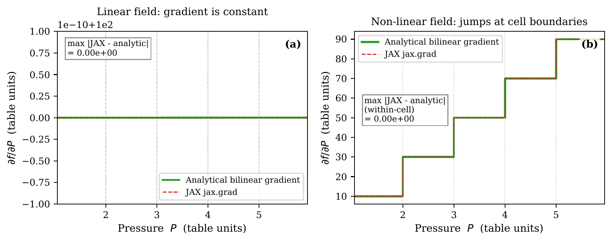
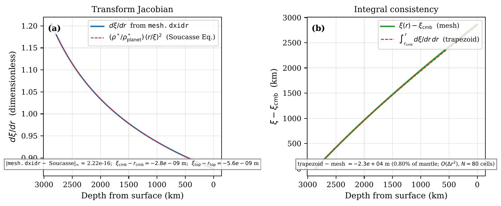
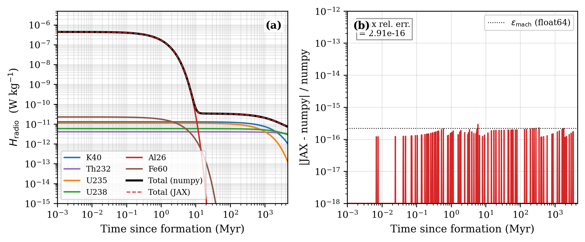
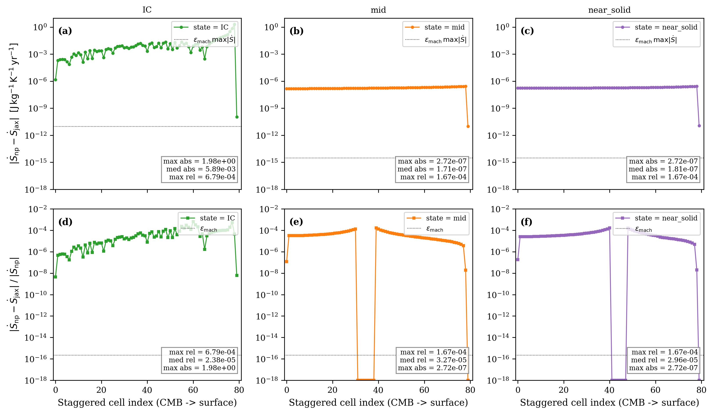
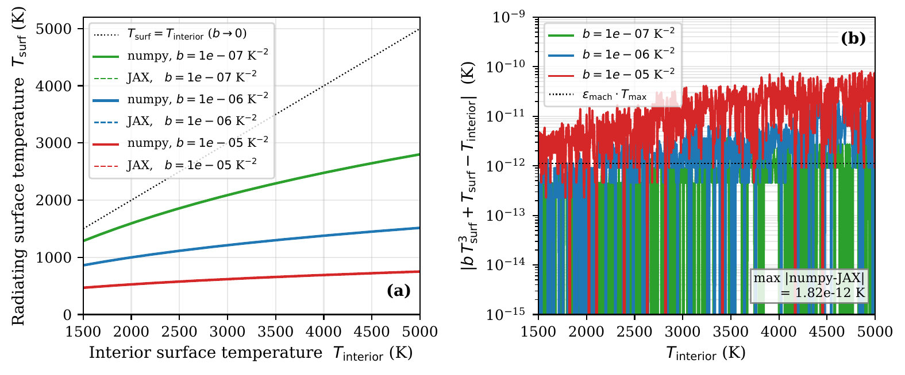

# First-principles verification

## What this page checks

This page checks the numerical solvers and physical conservation laws in Aragog.
Aragog solves the coupled equations of energy conservation, hydrostatic pressure, and mantle convection to simulate magma-ocean cooling and solid-mantle thermal evolution.
Validation here means running the solver on cases where another source provides the known answer.
The test then checks that the code matches that answer inside a stated numerical tolerance.
Known answers come from analytical limits, physical conservation laws, published benchmark studies, or independent second code paths.
If these numerical methods are wrong, the mantle calculates incorrect temperatures, melt fractions, and boundary heat fluxes.
Those errors then propagate directly into atmospheric outgassing, planet contraction, and orbital evolution in PROTEUS.
Each case below states why the check exists, what it tests, how we know the right answer, and why it matters.
The box "Test details" at the end of each case gives the reference, the tolerance, the test id, and the test command.

## Test categories

The tests are organised by the layer they cover:

### EOS unit tests (`tests/test_entropy_pytest.py`)

Exercise `EntropyEOS` and `EntropyPhaseEvaluator`:

- Property lookups (temperature, density, heat capacity, thermal expansivity, isentropic temperature gradient) at on-grid and off-grid $(P, S)$ points.
- Solidus and liquidus entropy lookups against the reference `solidus_P-S.dat` and `liquidus_P-S.dat` files.
- Smooth-clipped melt fraction $\phi(P, S)$: monotone in $S$, clamped to $[0, 1]$, $C^\infty$ through the solidus and liquidus crossings.
- The two-stage SPIDER-parity blend (cubic-Hermite or tanh smoothing followed by `combine_matprop`) for density, heat capacity, and viscosity.
- The latent-blend $c_p$ method against the linear blend.



**Figure 1.** JAX-traced bilinear interpolation of the EOS table reproduces the numpy reference to float-64 machine precision and supplies finite, non-zero derivatives via `jax.jacrev` at on- and off-grid $(P, S)$ points. The agreement is the prerequisite for the analytic Jacobian path used by CVODE.

### Phase evaluator tests

Test the SPIDER-parity behaviour of `EntropyPhaseEvaluator`:

- Phase identification at $(P, S)$ in pure solid, pure liquid, and mushy regimes.
- Viscosity tanh blend through the rheological transition $\phi_\mathrm{rheo}$.
- Gravitational-separation velocity in viscous and inviscid regimes.
- Pressure-dependent latent heat $L(P) = T_\mathrm{liq}(P) [S_\mathrm{liq}(P) - S_\mathrm{sol}(P)]$.

### Solver integration tests

Drive `EntropySolver` through short integrations and check the resulting profiles:

- Standalone grey-body cooling: a fully-molten initial state cools toward the equilibrium temperature without status flag failures.
- The `set_initial_entropy`, `set_initial_dSdr_cmb`, and `set_initial_core_temperature` paths produce the expected state-vector layouts for each of the five `core_bc` modes.
- The retry-ladder hooks (`get_current_dSdr_cmb`, `_atol_sf`) round-trip cleanly.

### Conservation tests (`tests/test_entropy_verification.py`)

The conservation tests are the strongest class of verification because they hold under any valid run, not just specific test scenarios:

- **Energy conservation.** $E_\mathrm{th}$ change over a closed integration matches the time-integrated surface flux within solver tolerance.
- **Mass conservation.** Mantle mass remains constant through phase changes.
- **Grey-body cooling.** Surface flux follows $\varepsilon\sigma(T_\mathrm{top}^4 - T_\mathrm{eqm}^4)$ inside tolerance once the radiative regime is established.



**Figure 2.** Mass-coordinate mesh Jacobian. The Newton solve that maps from mass coordinate to spatial radius (used when `mass_coordinates = true`) is monotone, smooth, and consistent with the analytic Adams-Williamson density profile. Departures here would propagate to mis-aligned cell volumes and a spurious mass-conservation residual in the integrator.



**Figure 3.** Radioactive heating $H_\mathrm{radio}(t)$ for the bundled isotope cocktail (Ruedas 2017): present-day specific powers ($^{40}\mathrm{K}$, $^{232}\mathrm{Th}$, $^{235}\mathrm{U}$, $^{238}\mathrm{U}$) decayed back to Solar System formation. Used as the source-term verification for the closed-mantle energy balance: the cumulative `step_dE_Q_radio_J` integral must match the time integral of $\rho \cdot H_\mathrm{radio}$ over each call to solver tolerance.

### JAX path tests (`tests/test_jax_entropy.py`)

Verify that the JAX-backed `EntropyEOS_JAX` and `compute_fluxes` agree with the numpy path:

- EOS parity: `EntropyEOS_JAX` returns the same temperature, density, heat capacity, thermal expansivity, $\partial T/\partial P|_S$, and conductivity as `EntropyEOS` on the same $(P, S)$ inputs.
- Phase evaluator parity: the JAX two-stage blend matches `EntropyPhaseEvaluator` to within floating-point tolerance.
- JIT and `vmap` compatibility: the JAX flux assembly is differentiable in full with `jax.grad`/`jax.jacrev` and survives JIT compilation without recompilation hot-spots.
- Boundary-copy tests: `dSdr` boundary values copy from the nearest interior node (SPIDER `ic.c:450` parity) instead of being extrapolated.
- Solver parity: integrating the same problem with the JAX-RHS-driven CVODE path and the numpy RHS produces matching trajectories.

### Numpy ↔ JAX RHS parity at representative magma-ocean states



**Figure 4.** Numpy $\leftrightarrow$ JAX RHS parity on an 80-cell Earth mesh at three representative magma-ocean states. *Top row, panels (a-c)*: per-cell **absolute** residual $|\dot S_\text{numpy} - \dot S_\text{jax}|$ in J/kg/K/yr; the dotted line is $\epsilon_\mathrm{mach}\,\max|\dot S|$ (the floating-point round-off floor expected on a single FP operation). *Bottom row, panels (d-f)*: per-cell **relative** residual $|\dot S_\text{numpy} - \dot S_\text{jax}|/|\dot S_\text{numpy}|$; the dotted line is float-64 machine epsilon. The three states are (a/d) initial condition (full magma ocean, $S \approx 3900$ J/kg/K, dimensionally uniform), (b/e) mid-solidification ($S = 3300 \to 3700$ J/kg/K from CMB to surface), (c/f) near-solid ($S = 3000 \to 3300$ J/kg/K).

Per-panel residuals:

- **Mid-solidification (b, e) and near-solid (c, f).** Interior cells sit at the float-64 round-off floor. Maximum absolute residual $\sim 3\times 10^{-7}$ J/kg/K/yr, dominated by a single spike at the surface boundary cell where the BC assembly is re-derived independently between numpy and JAX. Median relative error $\le 3\times 10^{-5}$.
- **Uniform-entropy IC (a, d).** Absolute residual $\sim 1$ J/kg/K/yr. Both paths run EOS lookup, lever-rule, and table interpolation on a uniform input; the arithmetic differs at the interpolation level. The relative error inflates because $|\dot S|$ itself is small in equilibrium.

Numpy and JAX paths are independent re-derivations, not a bit-exact port.



**Figure 5.** Surface-temperature correction from the upper-thermal-boundary-layer parameterisation (`solver/boundary.py::_utbl_tsurf`). The Cardano-formula solution to $b x^3 + x - T_\mathrm{int} = 0$ recovers $T_\mathrm{surf} < T_\mathrm{int}$ for the entire physical range and matches the cubic-equation residual to floating-point tolerance. Verifies the analytic surface boundary condition used when `param_utbl = true`.

### Mesh tests (`tests/test_jax_mesh_gravity_fallback.py`)

Verify that when the external mesh file (`eos_method = 2`) supplies an `eos_gravity` column, the JAX path interpolates the per-node gravity profile onto the basic grid rather than broadcasting a single scalar.

### Numpy <-> JAX RHS parity

**Why this check exists.** Aragog implements the right-hand side of the energy equation in both NumPy and JAX. The NumPy right-hand side is the reference implementation, and CVODE evaluates the compiled JAX right-hand side to integrate planet cooling. If the two paths differ in their rheology formulas or flux assembly, CVODE will integrate a different physical system than the reference equations. This test catches discrepancies in homologous temperature parameters on active-solid states (`abe_solid_kappah_floor_0`), where the JAX homologous perturbation probe produces relative differences in $[8.332 \times 10^{-3}, 1.0582 \times 10^{-2}]$ and fails the $10^{-6}$ tolerance by a factor of 8332 to 10582 ($> 8000\times$). It catches missing plastic yielding in JAX on yielded states (`abe_solid_yield_active`), where disabling plastic yielding produces relative differences in $[8.529 \times 10^{-5}, 1.340 \times 10^{-4}]$ and fails tolerance by a factor of 85 to 134 ($> 80\times$). The default state set (`abe_solid_default`) does not show either fault. The test also catches a missing or weakened viscosity law: on `abe_solid_kappah_floor_0` the law alone shifts the right-hand side by $[8.412 \times 10^{-3}, 1.0677 \times 10^{-2}]$, and the law-only guard requires $[4 \times 10^{-3}, 2 \times 10^{-2}]$ on the stored states and $[5 \times 10^{-3}, 2 \times 10^{-2}]$ on the live state ($1.037 \times 10^{-2}$). A law-cut mutant (rheology on with the rheology-off viscosity and mixing-length factor) gives 0 and fails it.

**What it tests.** With solid-state rheology enabled (`[phase_solid.rheology] enabled = true`), the right-hand side evaluates the rate of specific entropy change $\dot{S} = \partial S/\partial t$ in both `EntropyState.update` (NumPy) and `aragog.jax.phase.compute_fluxes` (JAX). The test reads a stored sweep of 100 cooling states on three state sets (`tests/reference/ssc_solver_wiring_benchmarks.json`, made by `tools/verification/generate_ssc_solver_wiring_benchmarks.py`) and evaluates one live profile per set:

1. Default configuration `cfg/abe_solid.toml`: initial entropy $S_\text{init} = 2900\text{ J/(kg K)}$, eddy-diffusivity floor $\kappa_{h,\text{floor}} = 10.0\text{ m}^2/\text{s}$, and solid reference viscosity $\eta_\text{solid} = 1.0\times 10^{21}\text{ Pa s}$. Solid rheology alters basic-node viscosity with solid blend weight $1 - w(\phi) > 0$ at all 100 basic nodes, with effective viscosity $\eta_\text{eff} = \eta_\text{diff}$ across all states ($n_\text{states}(\eta_\text{eff} \ne \eta_\text{diff}) = 0$). Rheology on vs off changes the right-hand side by $[8.101 \times 10^{-5}, 1.268 \times 10^{-3}]$. This change comes mostly from the solid-cell floor switch, not from the viscosity law: with rheology on, a fully solid cell gets no $\kappa_{h,\text{floor}}$.
2. Active-solid Arrhenius variant `abe_solid_kappah_floor_0`: $S_\text{init} = 2500\text{ J/(kg K)}$, bottom entropy $S_\text{bot} \in [1850, 2500]\text{ J/(kg K)}$, $\kappa_{h,\text{floor}} = 0.0\text{ m}^2/\text{s}$, $\eta_\text{solid} = 1.0\times 10^{18}\text{ Pa s}$, cohesion $c = 1.0\times 10^7\text{ Pa}$, friction coefficient $\mu = 0.1$, and maximum yield stress $\tau_{y,\text{max}} = 1.0\times 10^8\text{ Pa}$. Homologous Arrhenius strengthening ($\eta_\text{diff} \ge 10^{22}\text{ Pa s}$) keeps Pass 1 convective flux below conductive flux through the column ($f_\text{conv} < 0.5$), so `has_lid = False` and $n_\text{nodes}(\eta_\text{eff} \ne \eta_\text{diff}) = 0$ in all 100 states while Arrhenius strengthening changes the RHS by $[8.412 \times 10^{-3}, 1.0677 \times 10^{-2}]$ (and $0.99467$ along the integrated 100-yr trajectory on 60 basic nodes).
3. Yield-active state set `abe_solid_yield_active`: warm sub-solidus interior $S_\text{init} = 2150\text{ J/(kg K)}$, $S_\text{bot} \in [1950, 2150]\text{ J/(kg K)}$, $\Delta S \in [1620, 1820]\text{ J/(kg K)}$, $\kappa_{h,\text{floor}} = 0.0\text{ m}^2/\text{s}$, $\eta_\text{solid} = 3.0\times 10^{17}\text{ Pa s}$, $c = 150.0\text{ Pa}$, $\mu = 0.0$, and $\tau_{y,\text{max}} = 1.0\times 10^8\text{ Pa}$. Pass 1 interior convection exceeds conduction ($f_\text{conv} > 0.5$) beneath a cold conductive upper boundary layer (`has_lid = True` in all 100 states), generating driving stress $\tau_{d,\text{lid}} \gg \tau_{y,\text{lid}} = 150\text{ Pa}$ so plastic yielding reduces $\eta_\text{eff} < \eta_\text{diff}$ in 9 to 13 nodes in all 100 states. Yielding shifts the RHS relative to yield-off by $[8.529 \times 10^{-5}, 1.340 \times 10^{-4}]$ (median $9.520 \times 10^{-5}$). At the default `matprop_smooth_width = 0.01` the blend gives the two solid nodes above the solidus the small two-phase thermal expansivity of the test tables, so their mixing-length diffusivity is near 0 with and without yield.

When single-phase thermal expansivity $\alpha$ is harmonised between both paths (`identity_alpha = True`), `abe_solid_kappah_floor_0` is unchanged because two-phase latent-blend node 98 ($\phi = 0.5567$, $\rho_\text{sol} < \rho_\text{liq}$) uses `alpha_mixed` exclusively (`flux_vs_rhs_diagnostic`): a $1\text{ ULP}$ `jax.jit` division rounding difference in negative unclamped $\alpha_\text{mixed}$ ($-3.559 \times 10^{-4}\text{ K}^{-1}$) is amplified by cancellation in the smooth positivity clamp $\alpha = \frac{1}{2}(a + \sqrt{a^2 + \epsilon_\alpha^2})$ ($\epsilon_\alpha = 10^{-8}\text{ K}^{-1}$) into a $3.859 \times 10^{-7}$ relative shift in $\alpha_{98} = 7.024 \times 10^{-14}\text{ K}^{-1}$ and a maximum relative right-hand side difference of $4.584 \times 10^{-10}$ (median $3.521 \times 10^{-16}$, interior heat-flux relative difference $\le 5.095 \times 10^{-8}$; eager JAX at state 0 agrees with NumPy to $8.066 \times 10^{-16}$), asserted by the smoke test to within $10^{-9}$ ($2.18\times$ above $4.584 \times 10^{-10}$, corresponding to $2\text{ ULP}$ in unclamped $\alpha_\text{mixed}$). On `abe_solid_yield_active` and `abe_solid_default`, NumPy and JAX right-hand sides agree to floating-point round-off: $\le 1.097 \times 10^{-15}$ (median $2.823 \times 10^{-16}$, interior heat-flux relative difference $\le 9.510 \times 10^{-14}$) on `abe_solid_yield_active`, and $\le 4.998 \times 10^{-15}$ (median $2.127 \times 10^{-15}$, interior heat-flux relative difference $\le 1.669 \times 10^{-14}$) on `abe_solid_default`. With unharmonised single-phase $\alpha$ where `EntropyPhaseEvaluator` interpolates the table directly and `EntropyEOS_JAX` evaluates the thermodynamic relation, differences remain within $10^{-6}$ in all three state sets: $\le 4.584 \times 10^{-10}$ (median $5.509 \times 10^{-16}$, interior heat-flux relative difference $\le 5.095 \times 10^{-8}$) on `abe_solid_kappah_floor_0`, $\le 1.255 \times 10^{-7}$ (median $2.787 \times 10^{-8}$, interior heat-flux relative difference $\le 2.987 \times 10^{-5}$) on `abe_solid_yield_active`, and $\le 4.998 \times 10^{-15}$ (median $2.127 \times 10^{-15}$, interior heat-flux relative difference $\le 1.669 \times 10^{-14}$) on `abe_solid_default`. Live evaluation of a single profile verifies parity to within $2.5 \times 10^{-13}$ relative error.

**How we know the right answer.** The NumPy and JAX implementations are independent code paths that derive from the same physical formulas. They must yield identical right-hand side rates within floating-point round-off.

**Why it matters.** The integrator relies on the JAX right-hand side for speed and differentiability. Discrepancies between NumPy and JAX would mean that model predictions depend on which code path is active.

{ width="80%" }
{ width="80%" }

**How to read the plot.** The top row shows absolute differences between NumPy and JAX right-hand sides along mantle radius for the three state sets. The bottom row shows relative differences. The plot shows the stored 100-state sweep. A pass means that all points lie below the dashed tolerance line at $10^{-6}$.

??? info "Test details"
    - Reference: NumPy `EntropySolver.dSdt` two-pass implementation on `abe_solid_kappah_floor_0` (`s_init = 2500`, `kappah_floor = 0`, `viscosity_solid = 1e18`), `abe_solid_yield_active` (`s_init = 2150`, `kappah_floor = 0`, `viscosity_solid = 3e17`, `yield_stress_c = 150 Pa`), and inert default `abe_solid_default` (`s_init = 2900`, `kappah_floor = 10`, `viscosity_solid = 1e21`).
    - Tolerance: $\max_i |\dot{S}_{\text{NumPy}, i} - \dot{S}_{\text{JAX}, i}| / \max(|\dot{S}_{\text{NumPy}, i}|, 10^{-30}) \le 10^{-6}$ for all 100 states of each state set (asserted to $\le 10^{-9}$ for harmonised active-solid RHS parity); active-solid on-vs-off relative difference in $[4 \times 10^{-3}, 2 \times 10^{-2}]$ (live state $[5 \times 10^{-3}, 2 \times 10^{-2}]$) and yield-active yield-on vs yield-off relative difference $\ge 10^{-5}$ at every state (live state $\ge 5 \times 10^{-5}$).
    - Test id: `tests/test_rheology_solver_wiring_smoke.py::test_rhs_numpy_jax_parity_rheology_on`
    - Command: `pytest tests/test_rheology_solver_wiring_smoke.py -k test_rhs_numpy_jax_parity_rheology_on` (add `--validation-plots` to write the plot pair)

### Round-off perturbation spread with solid rheology

**Why this check exists.** Nonlinear rheology coupling can cause numerical instability where tiny floating-point round-off errors grow exponentially. This check verifies that microscopic initial perturbations do not cause divergent trajectory spreads during planetary thermal evolution.

**What it tests.** Five perturbed initial entropy profiles $S_0^{(k)}(r) = S_0(r)\left(1 + k \cdot 10^{-12}\right)$ ($k \in \{-2, -1, 0, +1, +2\}$) are integrated forward for 100 years on the active-solid variant (`s_init = 2500 J/(kg K)`, `kappah_floor = 0.0 m^2/s`, `viscosity_solid = 1.0e18 Pa s`) and the default `cfg/abe_solid.toml` (`s_init = 2900 J/(kg K)`, `kappah_floor = 10.0 m^2/s`, `viscosity_solid = 1.0e21 Pa s`). The spread $\Delta T(r) = \max_k T_k(r) - \min_k T_k(r)$ over all 100 basic nodes and all 99 staggered nodes measures trajectory sensitivity:

1. Active-solid variant (`abe_solid_kappah_floor_0`): solid rheology alters final temperatures by $\max_r |T_\text{on}(r, t_\text{end}) - T_\text{off}(r, t_\text{end})| = 7.9874\text{ K}$ ($T_\text{surf} = 482.079\text{ K}$ vs $481.618\text{ K}$, relative difference at the surface $(T_\text{on,surf} - T_\text{off,surf}) / T_\text{off,surf} = 9.570 \times 10^{-4}$, relative difference normalized by peak mantle temperature $\max_r |T_\text{on} - T_\text{off}| / \max_r T_\text{off} = 2.205 \times 10^{-3}$, RHS relative difference $7.656 \times 10^{-2}$, `visc_on != visc_off` at all 100 basic nodes, and $\kappa_{h,\text{on}} \ne \kappa_{h,\text{off}}$ at 60 basic nodes). Microscopic round-off perturbations yield maximum radial spread with rheology enabled of $\max_r \Delta T_\text{on}(r) = 2.128 \times 10^{-5}\text{ K}$ ($\Delta T_{\text{on,surf}} = 2.128 \times 10^{-5}\text{ K}$, $\Delta T_{\text{on,cmb}} = 1.232 \times 10^{-9}\text{ K}$, $\max_r \Delta T_{\text{on,stag}}(r) = 2.178 \times 10^{-5}\text{ K}$) against $\max_r \Delta T_\text{off}(r) = 1.232 \times 10^{-5}\text{ K}$ ($\Delta T_{\text{off,surf}} = 1.232 \times 10^{-5}\text{ K}$, $\Delta T_{\text{off,cmb}} = 1.255 \times 10^{-9}\text{ K}$, $\max_r \Delta T_{\text{off,stag}}(r) = 1.433 \times 10^{-5}\text{ K}$). The measured ratio $\max_r \Delta T_\text{on} / \max_r \Delta T_\text{off}$ is $1.727$; the deciding bounds are taken directly from the measurement, with the active-solid spread bounded by the $3.5 \times 10^{-5}\text{ K}$ ceiling ($1.64\times$ margin over the measured basic spread).
2. Default configuration `cfg/abe_solid.toml`: solid rheology alters final basic temperatures by $\max_r |T_\text{on}(r, t_\text{end}) - T_\text{off}(r, t_\text{end})| = 7.5340\text{ K}$, relative difference $2.052 \times 10^{-3}$, RHS relative difference $9.789 \times 10^{-2}$, with $\max_r \Delta T_\text{on}(r) = 5.946 \times 10^{-7}\text{ K}$ and $\max_r \Delta T_\text{off}(r) = 1.089 \times 10^{-6}\text{ K}$ ($\Delta T_\text{surf} = 5.946 \times 10^{-7}\text{ K}$). A run with the solid-cell floor switch and without the viscosity law changes the temperatures by $7.485\text{ K}$. Adding the viscosity law to that run changes them by at most $0.199\text{ K}$ more. Both are maxima over the radius, so they do not add up to $7.534\text{ K}$.

**How we know the right answer.** Trajectories with rheology enabled must remain stable: their perturbation spread must not exceed the deciding bound set from the measured spread with a stated margin ($3.5 \times 10^{-5}\text{ K}$ for active solid, $2.0 \times 10^{-6}\text{ K}$ for default).

**Why it matters.** Unstable numerical behaviour causes planetary thermal evolution simulations to diverge or crash during multi-gigayear coupled runs.

{ width="80%" }
{ width="80%" }

**How to read the plot.** The top panel shows end-time radial temperature profiles for rheology on and off on the active-solid variant. The bottom panel shows the radial perturbation spreads $\Delta T(r)$ from the stored runs. A pass means the active-solid curves with rheology on (basic and staggered nodes) stay below the dash-dot line ($3.5 \times 10^{-5}\text{ K}$) and the default curve stays below the dotted line ($2.0 \times 10^{-6}\text{ K}$). The active-solid staggered curve comes closest to its bound: its margin is $1.61\times$.

??? info "Test details"
    - Reference: 5 perturbed trajectories with `rheology.enabled = false` on the active-solid variant and default `cfg/abe_solid.toml` (`tests/reference/ssc_solver_wiring_benchmarks.json`).
    - Tolerance: $\Delta T_\text{on}(r) \le 3.5 \times 10^{-5}\text{ K}$ (margin $1.64\times$ over the measured basic spread $2.128 \times 10^{-5}\text{ K}$ and $1.61\times$ over the staggered spread $2.178 \times 10^{-5}\text{ K}$) on the active-solid variant and $\Delta T_\text{on}(r) \le 2.0 \times 10^{-6}\text{ K}$ on default, with active-solid on-vs-off relative difference $\ge 10^{-4}$.
    - Test id: `tests/test_rheology_solver_wiring.py::test_perturbed_starts_spread`
    - Command: `pytest tests/test_rheology_solver_wiring.py -k test_perturbed_starts_spread` (add `--validation-plots` to write the plot pair)

### Two-pass solid rheology RHS cost

**Why this check exists.** Solid rheology calculations execute inside the innermost loop of the differential equation solver. Redundant lookups or repeated compilation would make simulations run slowly. This check counts kernel executions and reads the stored execution times to confirm that two-pass solid rheology adds only the expected kernel calls and that the recorded JAX wall-time ratio stays below 1.5.

**What it tests.** Enabling two-pass solid rheology (`rheology.enabled = true`) reuses the basic-node solidus temperature $T_\text{sol}(P)$ already evaluated during phase lookup, skips staggered-node rheology viscosity via `defer_rheology_viscosity = True` (NumPy) and `include_rheology = False` (JAX), and calls the validation-free `_core` kernels directly inside the RHS. The test measures the call-count deltas live and reads the recorded wall times:

| Per-RHS item | Expected delta (`on - off`) | Measured `'lid'` delta (NumPy / JAX) | Measured `'local'` delta (NumPy / JAX) | Difference (`'lid'` - expected) | Reason |
|:---|:---:|:---:|:---:|:---:|:---|
| EOS lookups (solidus temperature) | `0` | `0 / 0` (`5 - 5` / `6 - 6`) | `0 / 0` | `0` | `T_sol(P)` is cached on basic nodes during phase evaluation and reused without extra EOS lookups. |
| `compute_arrhenius_viscosity` | `+2` | `+2 / +2` | `+1 / +1` | `0` | In `'lid'` mode: `1` vector call on $N_b$ basic nodes in phase evaluation plus `1` scalar call at $(T_i, P_i)$ inside `_compute_stagnant_lid_state_core` (`+2`). In `'local'` mode: `1` vector call on $N_b$ basic nodes (`+1`). |
| `compute_yield_stress` | `+2` | `+2 / +2` | `+1 / +1` | `0` | In `'lid'` mode: `1` vector call on $N_b$ basic nodes in phase evaluation plus `1` scalar call at $P_\text{lid,base}$ inside `_compute_stagnant_lid_state_core` (`+2`). In `'local'` mode: `1` vector call on $N_b$ basic nodes (`+1`). |
| `compute_stagnant_lid_state` | `+1` | `+1 / +1` | `0 / 0` | `0` | In `'lid'` mode: `1` call per RHS between Pass 1 (unyielded probe) and Pass 2 (`+1`). In `'local'` mode: active when `stress_closure_mode == 'lid'` (`0`). |
| `compute_effective_viscosity` | `+1` | `+1 / +1` | `+1 / +1` | `0` | `1` vector call on $N_b$ basic nodes in Pass 2 (`+1` in both `'lid'` and `'local'` modes). |
| `viscous_mixing_length_factor` | `+2` | `+2 / +2` | `+2 / +2` | `0` | Relative to `rheology.enabled = false` (`0` calls), Pass 1 (`theta = None`) and Pass 2 (`theta = lid_state['theta']` in `'lid'` mode, `None` in `'local'` mode) each invoke `_viscous_mixing_length_factor_core` once, giving `+2` calls per RHS in both NumPy and JAX. |

Each wall time is the minimum over 7 blocks of 1000 RHS evaluations on the 100-basic-node `cfg/abe_solid.toml` mesh (`tests/reference/ssc_solver_wiring_benchmarks.json`). The JIT-compiled JAX RHS wall-time ratio is $1.293\times$ in `'lid'` mode ($789.02\,\mu\text{s}$ vs $610.12\,\mu\text{s}$ per call) and $1.125\times$ in `'local'` mode ($686.30\,\mu\text{s}$ vs $610.12\,\mu\text{s}$ per call). The bound of $1.5\times$ applies to this recorded ratio: the test and the generator's `--check` read it from the stored benchmark, so a slowdown of the code is detected only when the benchmark is regenerated. It is not a performance target. On the eager NumPy path, the two-pass RHS wall-time ratio is $1.703\times$ in `'lid'` mode ($3087.04\,\mu\text{s}$ vs $1813.03\,\mu\text{s}$) and $1.128\times$ in `'local'` mode ($2045.50\,\mu\text{s}$ vs $1813.03\,\mu\text{s}$). The generator's `--check` accepts NumPy ratios in $[0.8, 2.5]$. The test sets no bound on them.

**How we know the right answer.** The expected call numbers come directly from code design: Pass 1 calculates unyielded convection and Pass 2 applies lid geometry and yielding. Wall times are measured by the benchmark generator against identical runs with rheology disabled and stored in the JSON; the test reads them.

**Why it matters.** Coupled planetary simulations run tens of thousands of solver steps. In the recorded benchmark, the JAX ratio of $1.293$ in `'lid'` mode means that solid-state convection adds about $29\%$ to the cost of the right-hand side. The ratios depend on the machine load at generation time. The test checks the recorded benchmark, so a new measurement needs a regeneration of the benchmark file.

{ width="80%" }
{ width="80%" }

**How to read the plot.** The top panel shows call counts for the six kernel components. Points show expected deltas, measured NumPy deltas, and measured JAX deltas (matching across all components). The bottom panel shows wall-time ratios for JAX (solid line) and NumPy (dashed line). A pass means JAX ratios remain below the dotted guard line at $1.5$.

??? info "Test details"
    - Reference: `rheology.enabled = false` per-RHS call counts and 1000-call wall time on `cfg/abe_solid.toml`.
    - Tolerance: per-RHS call-count deltas $(0, +2, +2, +1, +1, +2)$ in `'lid'` mode and $(0, +1, +1, 0, +1, +2)$ in `'local'` mode on both NumPy and JAX; JIT-compiled JAX wall-time ratio $\le 1.5$ (minimum over 7 blocks of 1000 calls, read from the stored benchmark).
    - Test id: `tests/test_rheology_solver_wiring.py::test_rhs_call_counts_and_cost`
    - Command: `pytest tests/test_rheology_solver_wiring.py -k test_rhs_call_counts_and_cost` (add `--validation-plots` to write the plot pair)

## Running the verification suite

The standalone suite uses `pytest`:

```sh
# Run the entire suite
pytest tests/

# Run a specific category
pytest tests/test_entropy_pytest.py
pytest tests/test_entropy_verification.py
pytest tests/test_jax_entropy.py

# Mark-filtered subsets
pytest -m unit tests/             # unit tests only
pytest -m smoke tests/            # smoke tests only
```

The JAX-path tests require `jax` and `equinox` to be installed; tests are skipped (not failed) when the optional dependencies are missing. Some tests also require the SPIDER-format EOS table directory; they look in `ARAGOG_TEST_EOS_DIR`, then in `$FWL_DATA/aragog/spider_eos`, then in a parity cache next to the repository (`tests/conftest.py`), and skip when none of them exists.

## Physical constraints checked

The suite asserts the following physical invariants on every solver-driven test run:

1. **Temperature positivity.** $T > 0$ everywhere at all integration times. EOS lookups outside the table domain raise rather than silently extrapolating.
2. **Melt fraction bounds.** $0 \le \phi \le 1$ via the smooth-clip; the assertion runs at every staggered node.
3. **Pressure positivity and monotonicity.** $P(r)$ is positive and decreases monotonically from CMB to surface.
4. **Entropy gradient continuity.** $\partial S/\partial r$ and the resulting fluxes are $C^0$ through the solidus and liquidus crossings (the smoothing functions enforce this).
5. **Energy conservation.** Within the integrator tolerance, $\Delta E_\mathrm{th}$ matches the time-integrated boundary fluxes plus internal heating sources.
6. **Mass conservation.** Total mantle mass is preserved under gravitational separation and chemical mixing (the segregation flux is divergence-free in mass).

## Phase-boundary rate controller verification

### What this section checks

This section verifies the event-driven phase-boundary rate controller (`phase_boundary_cap = "rate"`).
The controller regulates time steps in the CVODE solver near phase boundaries (solidus and liquidus) and during solid mantle cooling.
We verify that rate segmentation maintains temperature accuracy to $1.3 \times 10^{-4}\text{ K}$ against a high-resolution reference (`fixed` step size with tolerances of $10^{-10}$).
We also verify round-off stability, non-stalling behavior during mantle solidification, and coupled PROTEUS evolution.
The cases below evaluate accuracy, stiff-zone boundary landing, post-solidification stepping, and coupled behavior.

### Accuracy of event-driven rate segmentation at phase boundaries

**Why this check exists.**
Near phase boundaries, latent heat release causes sharp changes in effective heat capacity.
If time steps are too large near a phase boundary, the numerical integrator incurs large local truncation errors or step rejections.

**What it tests.**
Four test cases (Cases A, B, C, D) cover mushy initial conditions, different core boundary conditions, and spatial resolutions (16 to 24 nodes) with smoothing width $w = 0.01$.
The test compares the temperature profile $T(r)$ from `phase_boundary_cap = "rate"` at relative tolerance $10^{-8}$ against a high-resolution reference (`phase_boundary_cap = "fixed"` with $\Delta t = 1\text{ yr}$ and tolerances of $10^{-10}$).

**How we know the right answer.**
A fixed step size of $\Delta t = 1\text{ yr}$ with tolerances of $10^{-10}$ resolves phase boundaries with high precision.
Numerical errors stay near floating-point precision rather than temporal discretization limits.

**Why it matters.**
Accurate temperatures near phase boundaries set the timing and depth of magma ocean crystallization in planetary evolution models.

??? info "Test details"
    - Reference: Fixed $1\text{ yr}$ step size reference at relative and absolute tolerances of $10^{-10}$
    - Tolerance: $\max_i |T_{\text{rate}, 10^{-8}, i} - T_{\text{fixed}, 10^{-10}, i}| \le 1.3 \times 10^{-4}\text{ K}$ (observed: Case A $6.93 \times 10^{-6}\text{ K}$, Case B $8.65 \times 10^{-5}\text{ K}$, Case C $6.93 \times 10^{-6}\text{ K}$, Case D $2.83 \times 10^{-5}\text{ K}$)
    - Test id: V1
    - Command: `ARAGOG_TEST_EOS_DIR=... python tools/verification/run_phase_boundary_cap_accuracy.py --check`

### Stiff-zone boundary landing under slow cooling

**Why this check exists.**
When a cell cools slowly near the boundary, its cooling rate $|\dot{S}|$ can approach zero while the distance to the boundary remains small.
Without a floor on the effective progress distance, the step cap could collapse to the $1\text{ yr}$ minimum step bound, causing many tiny steps.

**What it tests.**
A 12-node column on the CI test table cools for $15\,000\text{ yr}$ under a prescribed surface flux $F = 20\text{ W/m}^2$, with `matprop_smooth_width` $= 0$, so that the stiff-zone half-width is $\delta = 10\text{ J/(kg K)}$.
Cells 4 and 5 start $11$ and $12.5\text{ J/(kg K)}$ above the solidus, just outside the stiff zone; the other cells start $10\text{ J/(kg K)}$ below it.
This case checks the step controller only; it is not a model of a planet.
The flux is chosen for the entropy range of the CI test table.
The test verifies that the stiff-zone landing rule ($d_{\text{eff}} = \max(d_{\text{near}}, 0.5\,\delta)$) lets these cells advance into Regime 3 without step collapse.

**How we know the right answer.**
The solution matches a high-precision reference solve with tolerances of $10^{-10}$ and stays inside the perturbation envelope $\Delta_{\text{pert}}(T)$ under $10^{-12}$ round-off perturbations.

**Why it matters.**
Slow cooling near the solidus occurs in long runs.
Without the distance floor, the controller takes $1\text{ yr}$ steps for as long as a cell stays near the boundary.

??? info "Test details"
    - Reference: Fixed $1\text{ yr}$ step size reference at tolerances of $10^{-10}$ and 5 round-off perturbations
    - Tolerance: $\|T_{\text{rate}}^{(0)} - T_{\text{fixed}, 10^{-10}}\|_\infty \le 1.3 \times 10^{-4}\text{ K}$ (observed: $3.62 \times 10^{-5}\text{ K}$, envelope $\Delta_{\text{pert}} = 3.40 \times 10^{-5}\text{ K}$)
    - Test id: V3-R3
    - Command: `ARAGOG_TEST_EOS_DIR=... python tools/verification/run_step_cap_validation.py --case v3_r3`

### Sub-solidus upper-bound relaxation and tolerance tightening

**Why this check exists.**
Once the entire mantle cools below the solidus, no phase boundary lies ahead in the cooling direction.
Imposing a $100\text{ yr}$ step ceiling on sub-solidus cooling slows down computation.
Removing the $100\text{ yr}$ ceiling without tightening tolerances could degrade solution accuracy.

**What it tests.**
A 12-node column on the CI test table cools for $200\,000\text{ yr}$ under a prescribed surface flux $F = 200\text{ W/m}^2$, with `matprop_smooth_width` $= 0$.
Every cell starts at the solidus entropy of the top cell plus $5\text{ J/(kg K)}$: the top cell starts above its solidus, the deeper cells start $306$ to $485\text{ J/(kg K)}$ below theirs.
This case checks the step controller only; it is not a model of a planet.
The flux is chosen so that every cell stays inside the entropy range of the CI test table.
Once all cells cool below the solidus, the upper step bound relaxes to $\infty$.
The segment tolerances then tighten to $\mathtt{rtol} \le 10^{-9}$ and $\mathtt{atol} \le 10^{-8}/\text{scale}$.

**How we know the right answer.**
The solution matches the fixed high-precision reference to $1.3 \times 10^{-4}\text{ K}$ in 1031 steps.

**Why it matters.**
Solid-state cooling after the magma ocean covers billions of years.
The relaxed step bound lets such runs finish in reasonable time; this case checks that the error stays inside the tolerance below.
The physical case for this regime is the [full solidification check](#full-solidification-without-solver-stalling): a 100-node mantle on the PALEOS low-temperature table.

??? info "Test details"
    - Reference: Fixed $1\text{ yr}$ step size reference at tolerances of $10^{-10}$ and 5 round-off perturbations
    - Tolerance: $\|T_{\text{rate}}^{(0)} - T_{\text{fixed}, 10^{-10}}\|_\infty \le 1.3 \times 10^{-4}\text{ K}$ (observed: $7.54 \times 10^{-5}\text{ K}$, envelope $\Delta_{\text{pert}} = 1.07 \times 10^{-6}\text{ K}$)
    - Test id: V3-R4
    - Command: `ARAGOG_TEST_EOS_DIR=... python tools/verification/run_step_cap_validation.py --case v3_r4`

### Full solidification without solver stalling

**Why this check exists.**
In 100-node runs, deep cells at high pressure stay close to the phase boundary for millions of years.
If the controller ties the step to their small distance from the boundary, the step size collapses and the run does not reach full solidification.
This case has 2 such points: $83.684\text{ Myr}$ with stagnant-lid rheology and $107.655\text{ Myr}$ without it.

**What it tests.**
A 100-node mantle on the PALEOS low-temperature equation of state tables cools from $S_0 = 3165.90\text{ J/(kg K)}$ under a grey-body surface ($T_{\text{eq}} = 273\text{ K}$), once with stagnant-lid rheology (`rheo_on`) and once without it (`rheo_off`), until full solidification ($\phi_{\max} = 0$).

**How we know the right answer.**
Each run must pass its stall point and reach $\phi_{\max} = 0$ with status 0.
Its entropy must stay inside the table.

**Why it matters.**
Long planetary evolution runs require robust integration from magma ocean through complete mantle solidification into solid-state convection.

**Known limit.**
The run stops at full solidification; the check does not integrate to $10^9\text{ yr}$.
The `rheo_on` run installs the JAX CVODE factory, as coupled PROTEUS runs do.

??? info "Test details"
    - Reference: Stall points at $83.684\text{ Myr}$ (`rheo_on`) and $107.655\text{ Myr}$ (`rheo_off`)
    - Tolerance: Each run passes its stall point and reaches $\phi_{\max} = 0$ with status 0; the entropy stays inside the table
    - Test id: V4
    - Command: `python tools/verification/run_step_cap_validation.py --case v4_rheo_off --eos-dir <PALEOS low-T table directory>`; the same with `--case v4_rheo_on`

### Coupled planetary evolution under super-solidus conditions

**Why this check exists.**
Coupling Aragog to the PROTEUS framework exchanges heat fluxes and boundary temperatures with the atmosphere model (JANUS).
The rules of the controller act only near and below the solidus.
A coupled run that stays above the solidus must therefore not change at all.

**What it tests.**
PROTEUS couples Aragog and JANUS for 5 iterations from $T_{\text{surf}} = 4000\text{ K}$.
The run stays above the solidus ($\Phi_{\text{global}} = 1$ at the end).
The rate cap never arms a segment.

**How we know the right answer.**
The end state is bitwise equal to that of the same run without the rules of the controller near and below the solidus.
This holds for the 9 tracked helpfile columns and for the staggered temperature and entropy profiles.

**Why it matters.**
Ensures the phase-boundary controller introduces no regressions into existing coupled magma ocean simulations.

??? info "Test details"
    - Reference: The same coupled run without the rules of the controller near and below the solidus
    - Tolerance: Bitwise equality of `Time`, `T_magma`, `T_surf`, `F_int`, `F_atm`, `Phi_global`, `M_mantle_liquid`, `M_mantle_solid`, `R_int` and the staggered profiles
    - Test id: V5
    - Config: `tools/verification/data/v5_aragog_janus.toml` (PROTEUS `d3f98e81365e728700884723fb820e00660d3793`)
    - Command: `proteus start --offline -c tools/verification/data/v5_aragog_janus.toml`

### Coupled planetary evolution crossing the solidus into the solid regime

**Why this check exists.**
When a coupled PROTEUS planet cools below the critical melt fraction into the solid regime, the interior solver transitions into Regime 4.
The coupled run must cross the solidus and execute solid-state steps smoothly.

**What it tests.**
PROTEUS couples Aragog and CALLIOPE from the mushy zone ($T_{\text{surf}} = 1750\text{ K}$).
The run stops 3 coupling steps after the global melt fraction reaches zero.

**How we know the right answer.**
A strict reference integrates every Regime 4 segment at rtol $10^{-10}$ with $1\text{ yr}$ steps.
Against that reference, the error of the run is not larger than the error of the same run without the rules of the controller near and below the solidus.
This holds for all 11 columns: the 9 tracked helpfile columns and the staggered temperature and entropy profiles.

**Why it matters.**
Shows stable coupling through the final stages of planetary solidification into the rocky mantle regime.

**Known limit.**
The relaxed step bound and the tighter tolerances in Regime 4 change step sizes and truncation errors by design.
The check therefore compares errors against the strict reference, not the end states of the 2 runs.

??? info "Test details"
    - Reference: Strict reference (rtol $10^{-10}$ with $1\text{ yr}$ steps in Regime 4) and the same coupled run without the rules of the controller near and below the solidus
    - Tolerance: The error against the strict reference is not larger than that of the run without those rules, on all 11 columns
    - Test id: V5b
    - Config: `tools/verification/data/v5b_zalmoxis_aragog_calliope.toml` (PROTEUS `a8bbd8751cb5040aedd90f7acb4a85755afae26b`)
    - Command: `python tools/verification/run_v5b_proteus.py`; the strict reference with `--reference`
